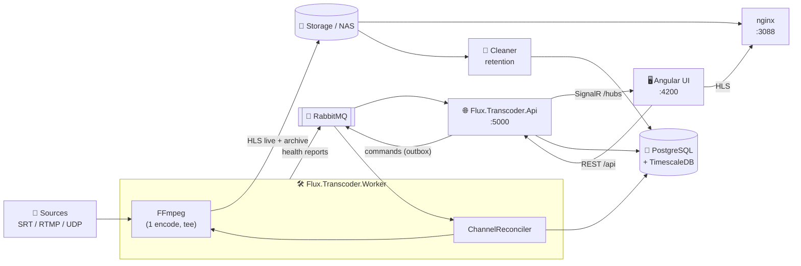

<div align="center">

# 🎬 Flux.Transcoder

**Live video transcoding and DVR: SRT / RTMP / UDP in, HLS live and archive out.**

[🇷🇺 Русский](README.ru.md) · 🇬🇧 English

[](https://dotnet.microsoft.com/)
[](https://angular.dev/)
[](https://material.angular.dev/)
[](https://www.typescriptlang.org/)

[](https://www.postgresql.org/)
[](https://www.timescale.com/)
[](https://www.rabbitmq.com/)
[](https://ffmpeg.org/)
[](https://docs.docker.com/compose/)

[](https://wolverinefx.net/)
[](https://learn.microsoft.com/aspnet/core/signalr/)
[](https://github.com/video-dev/hls.js)
[](https://tailwindcss.com/)
[](LICENSE.txt)

</div>

---

## 📖 About

Flux.Transcoder takes live streams from SRT, RTMP or UDP sources, encodes them with FFmpeg (x264, NVENC or QSV) and publishes two HLS outputs from a single encode: a short live window and a time-indexed archive on shared storage (NAS). The operator console shows every channel with live bitrate, uptime and dropped frames, plays live or any moment of the archive, and controls channels with start, stop and restart.

## ✨ Features

- 📡 **Ingest:** SRT, RTMP and UDP (MPEG-TS) sources.
- ⚙️ **Encoding profiles:** resolution, bitrate and encoder (x264 CPU, NVENC, QSV); presets 4K, 1080p, 720p, 480p.
- 🎞️ **One encode, two outputs:** FFmpeg `tee` writes live HLS and the archive at the same time.
- ⏪ **DVR:** watch from any moment by date and time, quick presets or a click on the bitrate chart.
- 🗑️ **Retention:** per channel from 1 minute up to 14 days; a separate cleaner removes old segments.
- 📊 **Metrics:** bitrate, uptime and dropped frames in real time (SignalR) and history in TimescaleDB.
- 🛡️ **Reliability:**
  - the worker keeps processes in line with the database, so channels come back after a worker restart;
  - commands go through a transactional outbox and survive broker or API outages;
  - automatic restart with exponential backoff, `Failed` after 8 attempts;
  - FFmpeg never outlives the worker (Job Object on Windows, `setpriv --pdeathsig` on Linux);
  - a standby worker takes over when the active one dies.
- 🖥️ **Operator console:** Angular Material 3, dark and light themes, Russian UI.
- 🔐 **Security:** JWT, users stored in the database, no secrets in the repository, login limited to 10 attempts per minute per IP. Everything except login requires a token: REST, the archive playlist, metrics and the SignalR hub (the connection closes when the token expires).

## 🏗️ Architecture



The database is the source of truth: a channel status and its `run_revision` say which FFmpeg process must be running. Queue messages only speed up reconciliation, so a lost, duplicated or reordered message does no harm.

## 🧰 Tech stack

| Area | Technologies |
|---|---|
| Backend | .NET 10, ASP.NET Core, Wolverine (mediator, HTTP endpoints, messaging, outbox), FluentValidation, Ardalis.Specification |
| Data | PostgreSQL 16, TimescaleDB (hypertable, continuous aggregates), Entity Framework Core 10 |
| Messaging | RabbitMQ |
| Video | FFmpeg, HLS, nginx |
| Frontend | Angular 22, Angular Material 3, Signal Forms, Tailwind CSS 4, hls.js, ApexCharts, SignalR |
| Logging | Serilog |
| Tests | xUnit, FluentAssertions, Vitest |

## 📁 Project structure

```text
Flux.Transcoder/
├── deploy/                        # docker-compose (PostgreSQL, RabbitMQ, nginx), nginx.conf
├── frontend/flux-frontend/        # Angular operator console
├── src/
│   ├── api/Flux.Transcoder.Api                # REST API, SignalR hub, DVR playlists, metrics
│   ├── application/
│   │   ├── Flux.Transcoder.Application        # commands, queries, validators, specifications
│   │   └── Flux.Transcoder.Contracts          # messages between API and worker
│   ├── domain/Flux.Transcoder.Domain          # channels, encoding profiles, users
│   ├── infrastructure/
│   │   ├── Flux.Transcoder.Ffmpeg             # FFmpeg arguments, process supervision, restarts
│   │   └── Flux.Transcoder.Infrastructure.Database  # EF Core, migrations, JWT, password hashing
│   └── worker/
│       ├── Flux.Transcoder.Worker             # runs FFmpeg, health reports, reconciliation
│       └── Flux.Transcoder.Cleaner            # archive retention
└── tests/Flux.Transcoder.Domain.Tests
```

## 🚀 Getting started

### Requirements

| Tool | Version |
|---|---|
| [.NET SDK](https://dotnet.microsoft.com/download) | 10 |
| [Node.js](https://nodejs.org/) | 22.22+, 24.15+ or 26+ |
| [FFmpeg](https://ffmpeg.org/download.html) | in `PATH` (or set `Ffmpeg:BinaryPath`); NVENC / QSV need a matching GPU |
| [Docker](https://www.docker.com/) | for PostgreSQL, RabbitMQ and nginx |

### 1. Infrastructure

Set the storage folder in `deploy/docker-compose.yml` (the `nginx` volume, `D:/fluxcast/storage` by default). Logins and passwords for PostgreSQL and RabbitMQ are read from `deploy/.env`, which is not in git:

```bash
cd deploy
cp .env.example .env      # then set your own passwords
docker compose up -d
```

### 2. Secrets

There are no passwords or keys in the repository. Without them the services refuse to start and name the missing setting. For local development keep them in [user-secrets](https://learn.microsoft.com/aspnet/core/security/app-secrets): one store is shared by the API, the worker and the cleaner.

```bash
P=src/api/Flux.Transcoder.Api
dotnet user-secrets set "ConnectionStrings:flux_transcoder_db" "Host=localhost;Port=5432;Database=flux_transcoder_db;Username=<POSTGRES_USER>;Password=<POSTGRES_PASSWORD>" --project $P
dotnet user-secrets set "ConnectionStrings:RabbitMq" "amqp://<RABBITMQ_USER>:<RABBITMQ_PASSWORD>@localhost:5672" --project $P
dotnet user-secrets set "Jwt:SigningKey" "<random string, at least 32 bytes>" --project $P
dotnet user-secrets set "Seed:AdminPassword" "<password of the admin user>" --project $P
```

On a server use environment variables instead: `ConnectionStrings__flux_transcoder_db`, `ConnectionStrings__RabbitMq`, `Jwt__SigningKey`, `Seed__AdminPassword`.

### 3. Backend

```bash
# API: applies migrations and creates the first user on start
dotnet run --project src/api/Flux.Transcoder.Api

# Worker: runs FFmpeg for active channels
dotnet run --project src/worker/Flux.Transcoder.Worker

# Cleaner: removes archive segments older than retention
dotnet run --project src/worker/Flux.Transcoder.Cleaner
```

### 4. Frontend

```bash
cd frontend/flux-frontend
npm install
npm start
```

Open http://localhost:4200 and sign in as `admin` with the password from `Seed:AdminPassword`.

> [!NOTE]
> If `Seed:AdminPassword` is not set, the API creates `admin` with a random password and prints it to the log once. A database created by an older version still has `admin` / `admin`: the API replaces it with `Seed:AdminPassword` on start and warns while it is not set.

### Useful URLs

| Service | URL |
|---|---|
| Operator console | http://localhost:4200 |
| API | http://localhost:5000 |
| API reference (Scalar, Development) | http://localhost:5000/scalar |
| HLS (nginx, local only by default, see `HLS_BIND` in `deploy/.env.example`) | http://localhost:3088 |
| RabbitMQ management | http://localhost:15672 |

## ⚙️ Configuration

Regular settings live in `appsettings.json` of each service, secrets in user-secrets or environment variables. Any setting can be overridden with an environment variable (`Section__Key`, for example `Ffmpeg__SegmentRoot`).

| Key | Service | Default | Meaning |
|---|---|---|---|
| `ConnectionStrings:flux_transcoder_db` 🔑 | API, Worker, Cleaner | required | database |
| `ConnectionStrings:RabbitMq` 🔑 | API, Worker | required | message broker |
| `Jwt:SigningKey` 🔑 | API | required, 32+ bytes | JWT signing key |
| `Seed:AdminPassword` 🔑 | API | random, printed once | password of the first `admin` |
| `Jwt:Issuer`, `Jwt:Audience` | API | `flux-transcoder` | JWT tokens |
| `Archive:SegmentRoot` | API | `D:\fluxcast\storage` | storage root for DVR playlists |
| `Archive:NginxBaseUrl` | API | `http://localhost:3088` | public HLS base URL |
| `Ffmpeg:BinaryPath` | Worker | `ffmpeg` | FFmpeg executable |
| `Ffmpeg:SegmentRoot` | Worker | `D:\fluxcast\storage` | where HLS is written |
| `Ffmpeg:HlsTimeSeconds` | Worker | `4` | segment length |
| `Ffmpeg:LiveListSize` | Worker | `6` | segments in the live playlist |
| `Ffmpeg:StartupTimeoutSeconds` | Worker | `30` | wait for the first segment before a restart |
| `Cleaner:ArchiveRoot` | Cleaner | `D:\fluxcast\storage` | storage root |
| `Cleaner:IntervalMinutes` | Cleaner | `1` | cleanup interval |

The storage root must be the same for the worker, API, cleaner and nginx.

## 🔌 API

| Method | Route | Purpose |
|---|---|---|
| `POST` | `/api/auth/login` | get a JWT |
| `GET` `POST` | `/api/channels` | list, create channels |
| `GET` `DELETE` | `/api/channels/{id}` | get, delete a channel |
| `POST` | `/api/channels/{id}/start` · `/stop` · `/restart` | control a channel |
| `PUT` | `/api/channels/{id}/retention` | archive retention |
| `GET` | `/api/channels/{id}/metrics?minutes=60` | bitrate history |
| `GET` | `/api/channels/{id}/archive?from=...` | DVR playlist from a moment |
| `GET` `POST` | `/api/profiles` | encoding profiles |
| WS | `/hubs/channels` | SignalR: `channelHealth`, `channelStatusChanged` |

## 🧪 Tests

```bash
dotnet test                        # domain tests
cd frontend/flux-frontend
npm test                           # frontend unit tests (Vitest)
```

## 📄 License

[MIT](LICENSE.txt) © 2026 13CyberPunk02
