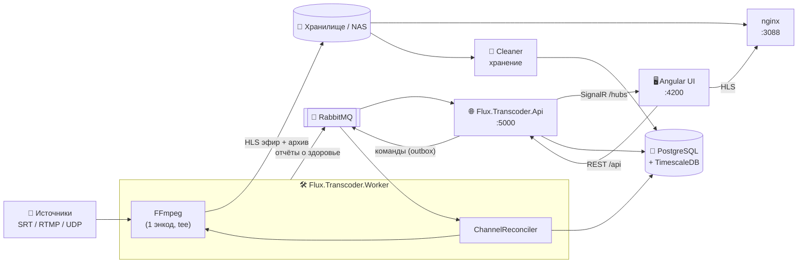

<div align="center">

# 🎬 Flux.Transcoder

**Транскодирование прямых эфиров и DVR: на входе SRT / RTMP / UDP, на выходе HLS эфир и архив.**

🇷🇺 Русский · [🇬🇧 English](README.md)

[](https://dotnet.microsoft.com/)
[](https://angular.dev/)
[](https://material.angular.dev/)
[](https://www.typescriptlang.org/)

[](https://www.postgresql.org/)
[](https://www.timescale.com/)
[](https://www.rabbitmq.com/)
[](https://ffmpeg.org/)
[](https://docs.docker.com/compose/)

[](https://wolverinefx.net/)
[](https://learn.microsoft.com/aspnet/core/signalr/)
[](https://github.com/video-dev/hls.js)
[](https://tailwindcss.com/)
[](LICENSE.txt)

</div>

---

## 📖 О проекте

Flux.Transcoder принимает прямые эфиры из SRT, RTMP или UDP, кодирует их через FFmpeg (x264, NVENC или QSV) и одним энкодом пишет два HLS-выхода: короткое окно прямого эфира и архив с разбивкой по времени на общем хранилище (NAS). Пульт оператора показывает все каналы с живым битрейтом, аптаймом и потерянными кадрами, проигрывает эфир или любой момент архива и управляет каналами: запуск, остановка, перезапуск.

## ✨ Возможности

- 📡 **Источники:** SRT, RTMP и UDP (MPEG-TS).
- ⚙️ **Профили кодирования:** разрешение, битрейт и кодек (x264 на CPU, NVENC, QSV); пресеты 4K, 1080p, 720p, 480p.
- 🎞️ **Один энкод, два выхода:** FFmpeg `tee` пишет эфир и архив одновременно.
- ⏪ **DVR:** просмотр с любого момента по дате и времени, быстрые пресеты или клик по графику битрейта.
- 🗑️ **Хранение архива:** для каждого канала от 1 минуты до 14 дней; старые сегменты удаляет отдельный чистильщик.
- 📊 **Метрики:** битрейт, аптайм и потерянные кадры в реальном времени (SignalR) и история в TimescaleDB.
- 🛡️ **Надёжность:**
  - воркер приводит процессы к состоянию в БД, поэтому каналы поднимаются после его перезапуска;
  - команды идут через транзакционный outbox и переживают падение брокера или API;
  - автоматический перезапуск с экспоненциальной паузой, после 8 попыток статус `Failed`;
  - FFmpeg не переживает воркер (Job Object на Windows, `setpriv --pdeathsig` на Linux);
  - резервный воркер подхватывает каналы, если активный упал.
- 🖥️ **Пульт оператора:** Angular Material 3, тёмная и светлая темы, интерфейс на русском.
- 🔐 **Безопасность:** JWT, пользователи в базе данных, секретов в репозитории нет, вход ограничен 10 попытками в минуту с одного IP. Всё, кроме входа, требует токен: REST, архивный плейлист, метрики и хаб SignalR (соединение закрывается, когда токен истекает).

## 🏗️ Архитектура



Источник истины здесь база данных: статус канала и его `run_revision` определяют, какой процесс FFmpeg должен работать. Сообщения из очереди лишь ускоряют сверку, поэтому потерянное, повторное или пришедшее не по порядку сообщение ничего не ломает.

## 🧰 Технологии

| Область | Технологии |
|---|---|
| Бэкенд | .NET 10, ASP.NET Core, Wolverine (медиатор, HTTP-эндпоинты, сообщения, outbox), FluentValidation, Ardalis.Specification |
| Данные | PostgreSQL 16, TimescaleDB (hypertable, continuous aggregates), Entity Framework Core 10 |
| Сообщения | RabbitMQ |
| Видео | FFmpeg, HLS, nginx |
| Фронтенд | Angular 22, Angular Material 3, Signal Forms, Tailwind CSS 4, hls.js, ApexCharts, SignalR |
| Логи | Serilog |
| Тесты | xUnit, FluentAssertions, Vitest |

## 📁 Структура проекта

```text
Flux.Transcoder/
├── deploy/                        # docker-compose (PostgreSQL, RabbitMQ, nginx), nginx.conf
├── frontend/flux-frontend/        # пульт оператора на Angular
├── src/
│   ├── api/Flux.Transcoder.Api                # REST API, SignalR-хаб, DVR-плейлисты, метрики
│   ├── application/
│   │   ├── Flux.Transcoder.Application        # команды, запросы, валидаторы, спецификации
│   │   └── Flux.Transcoder.Contracts          # сообщения между API и воркером
│   ├── domain/Flux.Transcoder.Domain          # каналы, профили кодирования, пользователи
│   ├── infrastructure/
│   │   ├── Flux.Transcoder.Ffmpeg             # аргументы FFmpeg, надзор за процессами, перезапуски
│   │   └── Flux.Transcoder.Infrastructure.Database  # EF Core, миграции, JWT, хеширование паролей
│   └── worker/
│       ├── Flux.Transcoder.Worker             # запуск FFmpeg, отчёты о здоровье, сверка с БД
│       └── Flux.Transcoder.Cleaner            # удаление архива по сроку хранения
└── tests/Flux.Transcoder.Domain.Tests
```

## 🚀 Быстрый старт

### Требования

| Инструмент | Версия |
|---|---|
| [.NET SDK](https://dotnet.microsoft.com/download) | 10 |
| [Node.js](https://nodejs.org/) | 22.22+, 24.15+ или 26+ |
| [FFmpeg](https://ffmpeg.org/download.html) | в `PATH` (или задать `Ffmpeg:BinaryPath`); для NVENC / QSV нужна подходящая видеокарта |
| [Docker](https://www.docker.com/) | для PostgreSQL, RabbitMQ и nginx |

### 1. Инфраструктура

Укажите папку хранилища в `deploy/docker-compose.yml` (том сервиса `nginx`, по умолчанию `D:/fluxcast/storage`). Логины и пароли PostgreSQL и RabbitMQ берутся из `deploy/.env`, которого нет в git:

```bash
cd deploy
cp .env.example .env      # затем задайте свои пароли
docker compose up -d
```

### 2. Секреты

Паролей и ключей в репозитории нет. Без них сервисы не стартуют и называют недостающий параметр. Для локальной разработки храните их в [user-secrets](https://learn.microsoft.com/aspnet/core/security/app-secrets): хранилище общее для API, воркера и чистильщика.

```bash
P=src/api/Flux.Transcoder.Api
dotnet user-secrets set "ConnectionStrings:flux_transcoder_db" "Host=localhost;Port=5432;Database=flux_transcoder_db;Username=<POSTGRES_USER>;Password=<POSTGRES_PASSWORD>" --project $P
dotnet user-secrets set "ConnectionStrings:RabbitMq" "amqp://<RABBITMQ_USER>:<RABBITMQ_PASSWORD>@localhost:5672" --project $P
dotnet user-secrets set "Jwt:SigningKey" "<случайная строка от 32 байт>" --project $P
dotnet user-secrets set "Seed:AdminPassword" "<пароль пользователя admin>" --project $P
```

На сервере вместо этого используйте переменные окружения: `ConnectionStrings__flux_transcoder_db`, `ConnectionStrings__RabbitMq`, `Jwt__SigningKey`, `Seed__AdminPassword`.

### 3. Бэкенд

```bash
# API: при старте применяет миграции и создаёт первого пользователя
dotnet run --project src/api/Flux.Transcoder.Api

# Воркер: запускает FFmpeg для активных каналов
dotnet run --project src/worker/Flux.Transcoder.Worker

# Чистильщик: удаляет сегменты архива старше срока хранения
dotnet run --project src/worker/Flux.Transcoder.Cleaner
```

### 4. Фронтенд

```bash
cd frontend/flux-frontend
npm install
npm start
```

Откройте http://localhost:4200 и войдите как `admin` с паролем из `Seed:AdminPassword`.

> [!NOTE]
> Если `Seed:AdminPassword` не задан, API создаст `admin` со случайным паролем и один раз напечатает его в лог. В базе, созданной прежней версией, у `admin` остался пароль `admin`: при старте API заменит его на `Seed:AdminPassword`, а пока он не задан, будет предупреждать.

### Полезные адреса

| Сервис | Адрес |
|---|---|
| Пульт оператора | http://localhost:4200 |
| API | http://localhost:5000 |
| Документация API (Scalar, Development) | http://localhost:5000/scalar |
| HLS (nginx, по умолчанию только локально, см. `HLS_BIND` в `deploy/.env.example`) | http://localhost:3088 |
| Управление RabbitMQ | http://localhost:15672 |

## ⚙️ Настройка

Обычные настройки лежат в `appsettings.json` каждого сервиса, секреты в user-secrets или переменных окружения. Любой параметр переопределяется переменной окружения (`Раздел__Ключ`, например `Ffmpeg__SegmentRoot`).

| Ключ | Сервис | По умолчанию | Назначение |
|---|---|---|---|
| `ConnectionStrings:flux_transcoder_db` 🔑 | API, Worker, Cleaner | обязателен | база данных |
| `ConnectionStrings:RabbitMq` 🔑 | API, Worker | обязателен | брокер сообщений |
| `Jwt:SigningKey` 🔑 | API | обязателен, от 32 байт | ключ подписи JWT |
| `Seed:AdminPassword` 🔑 | API | случайный, печатается один раз | пароль первого `admin` |
| `Jwt:Issuer`, `Jwt:Audience` | API | `flux-transcoder` | JWT-токены |
| `Archive:SegmentRoot` | API | `D:\fluxcast\storage` | корень хранилища для DVR-плейлистов |
| `Archive:NginxBaseUrl` | API | `http://localhost:3088` | публичный адрес HLS |
| `Ffmpeg:BinaryPath` | Worker | `ffmpeg` | исполняемый файл FFmpeg |
| `Ffmpeg:SegmentRoot` | Worker | `D:\fluxcast\storage` | куда пишется HLS |
| `Ffmpeg:HlsTimeSeconds` | Worker | `4` | длительность сегмента |
| `Ffmpeg:LiveListSize` | Worker | `6` | сегментов в плейлисте эфира |
| `Ffmpeg:StartupTimeoutSeconds` | Worker | `30` | сколько ждать первый сегмент до перезапуска |
| `Cleaner:ArchiveRoot` | Cleaner | `D:\fluxcast\storage` | корень хранилища |
| `Cleaner:IntervalMinutes` | Cleaner | `1` | интервал чистки |

Корень хранилища должен совпадать у воркера, API, чистильщика и nginx.

## 🔌 API

| Метод | Маршрут | Назначение |
|---|---|---|
| `POST` | `/api/auth/login` | получить JWT |
| `GET` `POST` | `/api/channels` | список, создание каналов |
| `GET` `DELETE` | `/api/channels/{id}` | получить, удалить канал |
| `POST` | `/api/channels/{id}/start` · `/stop` · `/restart` | управление каналом |
| `PUT` | `/api/channels/{id}/retention` | срок хранения архива |
| `GET` | `/api/channels/{id}/metrics?minutes=60` | история битрейта |
| `GET` | `/api/channels/{id}/archive?from=...` | DVR-плейлист с указанного момента |
| `GET` `POST` | `/api/profiles` | профили кодирования |
| WS | `/hubs/channels` | SignalR: `channelHealth`, `channelStatusChanged` |

## 🧪 Тесты

```bash
dotnet test                        # доменные тесты
cd frontend/flux-frontend
npm test                           # модульные тесты фронтенда (Vitest)
```

## 📄 Лицензия

[MIT](LICENSE.txt) © 2026 13CyberPunk02
